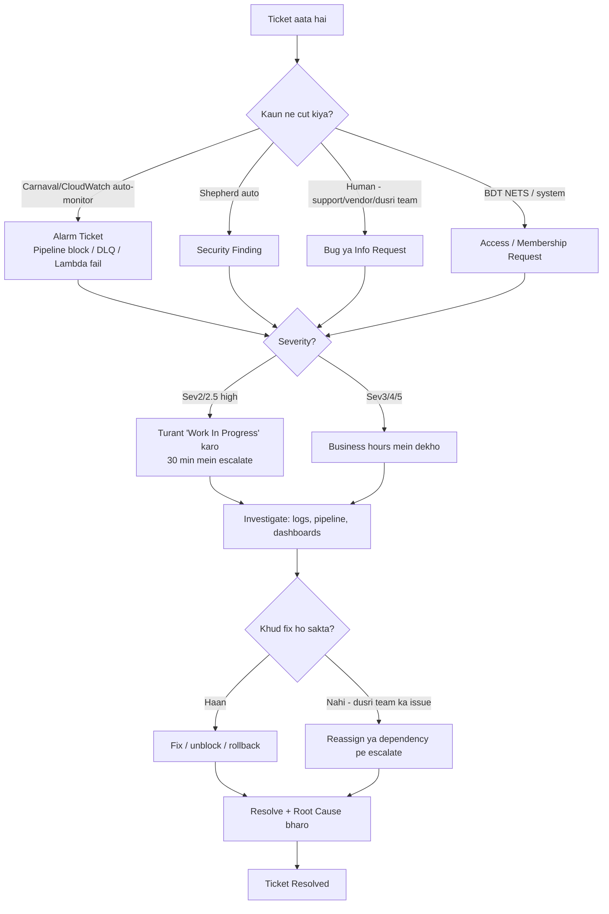

# SupplyChainExecDev — Oncall Ticket Types (New SDE Prep Guide)

> Tujhe 2-3 mahine baad oncall pe jaana hai. Yeh document batata hai ki **actual mein kis type ke tickets aate hein** teri team `SupplyChainExecDev` mein — sirf code bugs nahi, balki pipeline blocks, alarms, access requests, security findings sab. Data real tickets se nikala gaya hai (resolver group `SupplyChainExecDev`).
>
> **Scan scope (MAXIMUM confidence):** Poore **2 saal** (14 Oct 2024 – 14 Oct 2026) ke **saare 2,434 tickets ka 100% scan** kiya gaya (dono windows ki pagination end tak, startToken empty aa gaya):
> - Last 1 saal (Oct 2025–Oct 2026): **1,452 tickets** — 100% ✅
> - Pichla saal (Oct 2024–Oct 2025): **982 tickets** — 100% ✅
>
> **Confirmed: ye 10 categories hi hain, 11vi koi nahi** — poore 2 saal mein har ticket in 10 mein fit hua. Year-over-year growth: 982 → 1,452 (~48% zyada). Abhi currently sirf **23 open** pade hein.
>
> **Prior-year one-off:** 2025 mein ek "Logistics Analysis / Risk Assessment" data-report batch (EDD misses, lane delays) tha jo ab nahi aata — regular oncall pattern nahi, isliye alag category nahi banayi.
>
> **Volume:** ~**120 tickets/mahina**, roughly **~4/din**. Yeh teri daily oncall load ka realistic andaaza hai.

---

## Executive Summary (TL;DR)

Oncall pe jo tickets aate hein woh ab **10 bade category** mein aate hein (pehle 7 identify ki thi; poore saal ke scan mein 3 aur nikli). Code bug toh sirf ek chhota hissa hai. Realistically teri team mein ticket mix aisa hai:

| # | Ticket Type | Kitna common | Kaun cut karta hai | Difficulty (new SDE ke liye) |
|---|-------------|--------------|--------------------|------------------------------|
| 1 | **Pipeline Blocked** | 🔴 Bahut zyada | Carnaval auto-monitor | Easy–Medium |
| 2 | **Alarms — DLQ / Lambda fail / Availability / Latency** | 🔴 Bahut zyada | CloudWatch alarm | Medium |
| 3 | **Security Findings (Shepherd)** | 🔴 Bahut zyada | Shepherd (auto) | Easy (zyadatar auto-close) |
| 4 | **Access / Membership / Ownership Requests** | 🟡 Zyada | Humans / BDT NETS | Easy |
| 5 | **Customer / Vendor-reported Bugs** | 🟡 Medium | Humans (support, VC team) | Medium–Hard |
| 6 | **Cross-team / Dependency / Migration / Info** | 🟡 Medium | Dusri teams | Medium |
| 7 | **Actual Code Defects (functional bugs)** | 🟢 Kam-medium | Alarm ya human | Hard |
| 8 | **Policy Engine / Governance / Compliance** | 🟢 Kam | PE / Ops Trust (auto) | Easy–Medium |
| 9 | **Cradle / DataCraft / ETL Batch-Job Failures** | 🟡 Medium | Cradle/DataCraft alert | Medium |
| 10 | **Quilt Patching / OS / Certificate / Infra** | 🟢 Kam | Quilt / Redfort (auto) | Easy–Medium |

**Sabse important insight:** Oncall ka ~60-70% kaam **"operational noise"** hai — pipeline unblock karna, DLQ drain karna, alarm acknowledge karna, auto-security findings resolve karna. Sirf ~20-30% hi "baitho aur code debug karo" wala kaam hai. Yeh naye SDE ko surprise karta hai, isliye tu pehle hi jaan le toh fayda hoga.

**Top-3 by volume (poore saal ke scan se):** Pipeline Blocked, Shepherd Security Findings, aur Access-request tickets — ye teen milke oncall ka bada hissa khaate hein. Baaki alarms (DLQ/availability) bhi roz aate hein.

---

## Team Context

`SupplyChainExecDev` — ROW Ops Software Dev ke under, Amazon Logistics (Corporate), **Gurgaon** based. Services vendor returns, shipment tracking, appointment scheduling (VASTUI), forecasting (UFPP), aur fulfillment orchestration ke liye hein — IN, EU, NA marketplaces mein.

- **Resolver Group:** `SupplyChainExecDev` (id `000000009391438`)
- **CTI:** Category = `Amazon.in`, Type = `Supply Chain Dev` / `FBA`, Item = service ka naam
- **Business hours:** 10:30–17:00 IST (Asia/Kolkata), Mon–Fri
- **Daytime Sev-2 enabled:** Sev-3 business hours mein 30 min baad auto-upgrade ho jaata hai
- **Manager / escalation:** gtarun
- **Team email:** in-supplychain-devs@amazon.com

### Services tu dekhega (ticket "Item" field mein)
AtronAutoOrderDrop, VASTUI, VendorReturnShipmentVisibility, TinyRedButton (TRB), ElectronicProofOfDelivery (ePOD), TBOrchestratorService (TBOS), CMS, InvincibleService / VIXApplication, UFPPWebApp, SXDashboard, RemovalsEventsRouter, VendorReturnsBulkDownload, OutboundIVRCallService, ROW-QC.

---

## Ticket Flow — Oncall Kaise Kaam Karta Hai

---

## Category 1 — Pipeline Blocked 🔴 (sabse common)

**Title aisa dikhta hai:**
> `AtronAutoOrderDrop Pipeline: Pipeline blocked. One or more builds, deployments, or workflows in this pipeline have failed or a promotion is blocked.`

**Kya hota hai:** Jab kisi pipeline ka build fail ho jaata hai, ya koi deployment stuck ho jaata hai, ya koi check (Gordian Knot, CloudCover coverage, Code Guardian, Integration Tests) promotion rok deta hai — toh **Carnaval monitor automatically ticket cut kar deta hai**. Koi insaan nahi likhta, machine likhti hai.

**Ye "merge from live se block" wala exactly hai jo tune poocha tha** — jab tera code mainline pe merge hota hai aur koi gate (jaise CloudCover coverage threshold, ya GK ka RECALLED dependency) use rok deta hai, toh pipeline block ho jaata hai aur ye ticket aa jaata hai.

**Real examples jo abhi aaye:**
- `VIXApplication Pipeline: Pipeline blocked` (abhi Open, 14 Oct)
- `OutboundIVRCallService Pipeline: blocked` (Open)
- `ElectronicProofOfDeliveryServiceLambda Pipeline: blocked`
- `TBOrchestratorService-mainline Pipeline: blocked`
- `UFPPWebApp Pipeline: blocked`

**Root causes jo ye tickets close karte waqt lagaaye gaye:**
- `Testing/QA gap` (coverage threshold fail)
- `Deployment issue - manual`
- `Infrastructure Maintenance`
- `False Alert` (pipeline khud theek ho gaya, bas noise tha)
- `Application defect - Coding` (asli build break)

**New SDE ke liye:** Ye zyadatar **easy-medium** hain. Pipeline kholo → dekho kaunsa stage red hai → failure padho → ya fix karo ya offending revision rollback karo. Kabhi-kabhi ye sirf "False Alert" hota hai (pipeline khud recover ho gaya), toh resolve kar do.

---

## Category 2 — DLQ & Lambda Failure Alarms 🔴 (bahut common)

**Title aisa dikhta hai:**
> `[ALARM] [us-east-1] BarcodeAddedEventLambdaDLQ_BreachingThreshold`
> `[ALARM] [eu-west-1] CMSEventsProcessor DLQ Count breached Sev-3`
> `Messages in ShipmentTrackingFilteredEventsDLQ ... are more than expected`
> `VendorRemovalsShipmentTracki-ShipTrackEventHandler Lambda failed`

**Kya hota hai:** Teri services event-driven hain (SQS/SNS + Lambda). Jab koi message process nahi ho paata, woh **DLQ (Dead Letter Queue)** mein chala jaata hai. Jab DLQ mein messages ek threshold se zyada ho jaayein, ya Lambda baar-baar fail ho, toh **CloudWatch alarm ticket cut kar deta hai**.

> **GCP mapping (tere background ke liye):** DLQ ≈ Pub/Sub ka dead-letter topic. Lambda ≈ Cloud Function. CloudWatch alarm ≈ Cloud Monitoring alert policy.

**Real examples:**
- `BarcodeAddedEventLambdaDLQ_BreachingThreshold` (ePOD, Open)
- `RemovalsShipmentFilteredEventsDLQ_Messages_GreaterThanExpected`
- `TRBEventsLambda failures` (eu-south-2)
- `TRBEventsLambda-prod-NA-TRBFexOSSyncHandler-Iterator-Age-Max-Warning`

**Root causes jo lagaaye gaye:**
- `Application defect - Coding` / `Application defect - Config`
- `External Dependent Platform Issue` (dusri team ki service down thi)
- `Network Problem`
- `Performance issue`
- `Lack of Monitoring`

**New SDE ke liye:** Ye **medium** hain. DLQ messages dekho → kyun fail hue samjho → agar transient tha (dependency down thi), redrive kar do; agar code bug hai toh fix chahiye. "Iterator Age" matlab Lambda messages ke saath peeche padh gaya hai (lag ho raha hai).

---

## Category 3 — Security Findings (Shepherd) 🟡 (zyada, par aasaan)

**Title aisa dikhta hai:**
> `[Shepherd] IAM User with Multiple Active Access Keys - 2 Issues detected`
> `[Shepherd] Eliminate SSH Access for Hostclasses - 1 Issue detected`
> `[Shepherd] ECR images with Vulnerabilities used in Active Container Tasks`
> `[Shepherd - Notification] Automated action taken on AWS resource in InvincibleService - Beta`

**Kya hota hai:** **Shepherd** Amazon ka automated security-risk tool hai. Jab tera koi AWS resource security policy todta hai (purani access key, SSH khula hua, vulnerable container image), toh Shepherd ticket cut karta hai. Bahut saare **automatically close** ho jaate hein jab resource theek ho jaata hai.

**Root cause:** `Security` → closure `Automatically Closed`.

**New SDE ke liye:** Zyadatar **easy** — bahut saare khud auto-resolve ho jaate hein. Jo manual action maangte hein (access key rotate karo, SSH band karo), unke liye Shepherd ka link follow karo. Security ticket ignore mat karna — ye compliance ke liye track hote hein.

---

## Category 4 — Access / Membership Requests 🟡 (zyada, bahut aasaan)

**Title aisa dikhta hai:**
> `[Action Required] Access request for Default data scope needs your review by Oct 29, 2026`
> `Membership request for team "ACDC_SPCE"`

**Kya hota hai:** Koi banda team ya data scope ka access maangta hai, ya BDT (Business Data Technologies) data access ko review ke liye bhejta hai. Kuchh `Auto resolved by BDT NETS` ho jaate hein.

**New SDE ke liye:** **Easy.** Request dekho, approve/deny karo (ya senior se poochho agar sure nahi), resolve. Code se koi lena-dena nahi.

---

## Category 5 — Customer / Vendor-reported Bugs 🟡 (medium-hard)

**Title aisa dikhta hai (ye asli "insaan ne likha" wale hote hein):**
> `Vendor cannot see appointment slots` (VASTUI)
> `[VC Product Returns] Carrier RTV/VRET tracking IDs not visible in Vendor Central`
> `VAST not showing the validation error message when editing an appointment`
> `WhatsApp Responses Not showing on ACDC 2.0`
> `Timezone issue while fetching the data` (AtronAutoOrderDrop)

**Kya hota hai:** Asli users (vendors, internal ops teams, support) jab kuchh toota hua dekhte hein toh ticket cut karte hein. Ye **sabse "real debugging"** wale tickets hote hein — tujhe reproduce karna padta hai, logs dekhne padte hein, code samajhna padta hai.

**Root causes:**
- `Application defect - Coding`
- `Existing Bug in Production`
- `By Design` (actually bug nahi tha, aise hi design hai — explain karke close)
- `Request / Information Related` (sirf info chahiye thi)

**New SDE ke liye:** **Medium-hard.** Yahi woh "code bug" wala kaam hai jo tu soch raha tha. Patience chahiye — reproduce → logs → root cause → fix ya explain.

---

## Category 6 — Cross-team / Dependency / Info Requests 🟡

**Title aisa dikhta hai:**
> `[Action requested by 2026-10-15] TEX is removing NFA failure reason codes from transferInventory rejections for AtronAutoOrderDrop`
> `Confirmation if Cancel SNS notification from FEX is required`
> `[MCCF NCPR] Impact check: FBA/MCF seller removal orders flowing as sourceId NETWORK_CONS`
> `[Alert] Cradle job crossdock-allocation-dump-mena ... failed`

**Kya hota hai:** Dusri teams tumse coordination maangti hein, ya tumhari upstream dependency (TEX, FEX, Cradle, Andes) kuchh change kar rahi hai jisse tumhe impact check karna hai. `External Dependent Platform Issue` root cause yahan bahut aata hai.

**New SDE ke liye:** **Medium.** Technical knowledge + communication dono chahiye. Senior se poochne mein sharam mat karna — ye tickets context-heavy hote hein.

---

## Category 7 — Actual Functional Code Defects 🟢 (kam-medium, par hard)

Ye alarms/pipeline ke andar chhupe hote hein — jab root cause `Application defect - Coding` ya `Existing Bug in Production` nikle. Pure "naya functional bug" standalone kam aate hein; zyadatar ek alarm ya customer complaint ke roop mein aate hein, aur investigate karne pe code defect nikalta hai.

---

## Category 8 — Policy Engine / Governance / Compliance 🟢 (naya, poore-saal scan se)

**Title aisa dikhta hai:**
> `[Policy Engine] [Deployment Safety] AppConfig CDK - Max Linear Growth`
> `[Policy Engine] [Deployment Safety] AppConfig CDK - Missing Monitors`
> `[Ops Trust] Mandatory AI System Compliance - InvincibleService`
> `[Action Required] New AWS Account/Service Onboarding Checklist`
> `Overdue POTB Dependent Table Classifications`

**Kya hota hai:** Ye **compliance / governance** tickets hein — Shepherd (security) se alag. Policy Engine deployment config ki safety rules check karta hai, Ops Trust AI-system compliance maangta hai, aur naye AWS account/service onboarding checklists aate hein. Zyadatar auto-generated, deadline ke saath.

**New SDE ke liye:** **Easy-medium** — zyadatar checklist follow karna ya config theek karna. Code debugging nahi.

---

## Category 9 — Cradle / DataCraft / ETL Batch-Job Failures 🟡 (naya)

**Title aisa dikhta hai:**
> `[Alert] Cradle job crossdock-allocation-dump-mena ... failed`
> `[Alert] Cradle job MENA_Demand_Forecast_S3_Andes_Prod failed`
> `[Alert] Event failure in DataCraft pipeline vendor-removals-dw-prod-dcv3`
> `[Alert] DataCraft pipeline thor-barcode-details-beta automatically paused`
> `TBOS ETL Job Failed` (bahut baar repeat)
> `[UFPP] Airflow DAG Concurrency Issue - Trans_Planning_Workflow Runs Stuck`
> `Variant based Compaction subscription ... suspended`

**Kya hota hai:** Teri team ke paas scheduled **data/ETL jobs** hein (Cradle, DataCraft, Airflow/MWAA DAGs, Andes dumps, TBOS ETL). Jab koi job fail ya pause ho jaaye, alert ticket cut hota hai. Ye CloudWatch/DLQ alarm se **alag** hai — yahan data-pipeline fail hui hai, service nahi.

> **GCP mapping:** Cradle/DataCraft ≈ scheduled Dataflow/Composer (Airflow) jobs. MWAA = Managed Workflows for Apache Airflow.

**New SDE ke liye:** **Medium.** Job logs dekho → kyun fail/pause hui → re-run ya upstream data theek hone ka wait. `TBOS ETL Job Failed` aur UFPP MWAA/Airflow issues recurring hein, inke runbook pehle se padh lena.

---

## Category 10 — Quilt Patching / OS / Certificate / Infra 🟢 (naya)

**Title aisa dikhta hai:**
> `[Quilt] Patching workflow for TBOrchestratorService ... has FAILED`
> `Some of the Quilt pipelines need attention`
> `[Shepherd] Update operating system - 2 Issues detected`
> `[Redfort] Notification for binding of Certificate for ...clouddesk...`
> `[Certificate Metric Missing | daysToExpiry] Immediate Action Required`
> `A VPC you own in us-west-2 has been onboarded to BigMesh Global Endpoints`
> `CMSWebApp Pipeline: Pipeline disabled` (block se alag — jaan-boojh ke band)

**Kya hota hai:** Host/OS **patching** (Quilt), TLS **certificate** renewal (Redfort), **VPC/networking** (BigMesh/SuperStar) aur pipeline-**disabled** notifications. Yeh infra-maintenance type hai — zyadatar auto, par kuchh action maangte hein (cert bind karo, patch workflow re-run karo).

**New SDE ke liye:** **Easy-medium** — follow the tool's link, run the patch/renew step. Certificate expiry ignore mat karna (service down ho sakti hai).

---

## Real High-Sev Examples (poore saal se — taaki pata ho "bada" ticket kaisa hota hai)

Ye woh tickets hein jo high-impact the — inse andaaza lagega ki serious ticket kaisa dikhta hai:
- `URGENT: SD Shipment PDD Generation Failure and EDD>PDD - ~2.7MM Impact - Immediate Action Required`
- `VASTUI-IN-PROD-SEV2 [CompositeAlarm]`
- `[ALARM] ORCA/RemovalsOrchestrator:...CreateOrderWorkflow-SEV2`
- `[ALARM] [SEV2] UFPP-MWAA-Environment BaseWorker CPUUtilization above threshold`
- `[Urgent] Mismatch between TAR created and RCA refund amount`
- `Incorrct GST rate applied on e invoices` (financial correctness — serious)

Note karo: high-sev zyadatar **composite alarms** (poori service down), **financial mismatches** (tax/refund/GST), ya **bada customer impact** (millions of shipments) hote hein. Inpe turant 'Work In Progress' + escalate.

---

## Severity Guide (yaad rakhne layak)

| Severity | Matlab | Response time |
|----------|--------|---------------|
| **Sev-1** | Sabse bada — bada outage | Turant, all-hands |
| **Sev-2 / 2.5** | High — customer impact | Turant 'Work In Progress' karo; 30 min mein auto-escalate |
| **Sev-3** | Medium | Business hours mein; daytime Sev-2 ban sakta hai 30 min baad |
| **Sev-4 / Sev-5** | Low — zyadatar auto-alarm noise | Backlog, SLA ke hisaab se |

> ⚠️ **Golden rule:** High-sev (Sev2/2.5) ticket ko 'Assigned' pe mat chhodna — woh primary oncall ko dobara page karega aur 30 min mein escalate ho jaayega. Check-in karte hi status 'Work In Progress' kar do.

---

## Ek Real Ticket Andar Se Kaisa Dikhta Hai

Example: `AtronAutoOrderDrop Pipeline: Pipeline blocked` (V2406495597)

- **Submitter:** `flx-cloudwatch` (machine, insaan nahi)
- **Case Type:** `Patrol Auto Submit`
- **Severity:** Sev-5
- **Description:** Pipeline ka link + Carnaval monitor link + alarm details
- **SmartTTBots** automatically pichle similar tickets dikhata hai with past root causes — ye tera **sabse bada dost** hai. Pehle ye dekho ki pehle kis ne, kaise fix kiya tha.
- Is case mein pushkern ne resolve kiya, root cause `Infrastructure Maintenance`.

**Lesson:** Har auto-cut ticket pe SmartTTBots "Similar tickets in past" comment deta hai. Oncall ka pehla kadam hamesha: *"ye pehle hua hai? kaise fix hua tha?"*

---

## Oncall Shuru Karne Se Pehle Checklist (mera suggestion)

1. **Team ka oncall runbook padho** — har service ka apna runbook hota hai (AtronAutoOrderDrop ka wiki mein hai). Rollback steps, valid test data, escalation contacts sab usme hote hein.
2. **Shadow karo** — pehli rotation mein kisi senior ke saath baith ke dekho woh tickets kaise handle karte hein.
3. **Dashboards bookmark karo** — har service ka CloudWatch/Carnaval dashboard.
4. **SmartTTBots trust karo** — har auto-ticket pe past-fixes dekho pehle.
5. **Escalate karna seekho, sharam mat karo** — stuck ho toh secondary oncall ya gtarun ko turant batao. Sev2 pe akela ghanto mat atko.
6. **Root cause sahi bharo** — resolve karte waqt root cause mandatory hai is team mein. Galat mat bharo, warna metrics kharab hote hein.

---

## Sources

- [SupplyChainExecDev resolver group config + 80 recent tickets](https://t.corp.amazon.com) (SIM-T ticketing API, resolver group `SupplyChainExecDev`) — accessed 2026-10-14
- [AtronAutoOrderDrop Project Wiki (oncall/runbook/escalation)](https://w.amazon.com/bin/view/InternationalCountryExpansion/A2I/SellerExperience/SupplyChainExecDev/Projects/AtronAutoOrderDrop/) — accessed 2026-10-14
- [[Supply Intelligence] Oncall Expectations & Responsibilities (general oncall practices)](https://w.amazon.com/bin/view/Galaxy-apps/SupplyPlanning/Operations/SPCoreOncallExpectationsAndResponsibilities/) — accessed 2026-10-14
- [VIXApplication Project Wiki (CTI + oncall runbook refs)](https://w.amazon.com/bin/view/InternationalCountryExpansion/A2I/SellerExperience/SupplyChainExecDev/Projects/Invincible/VIXApplication/About/) — accessed 2026-10-14
- [SmartTTBots (auto similar-ticket suggestions on tickets)](https://w.amazon.com/bin/view/SmartTTBots/) — accessed 2026-10-14
